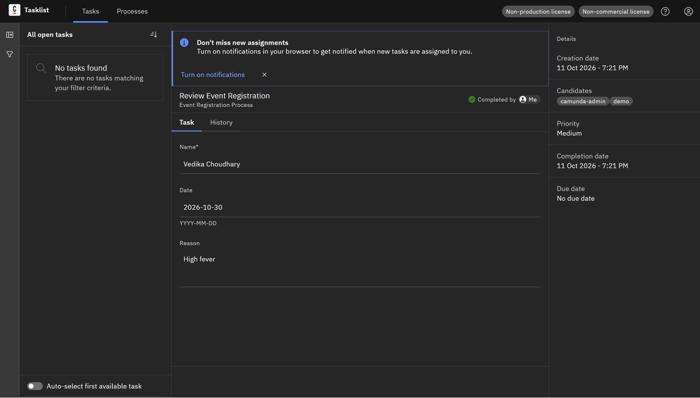

# Event Registration Workflow (Camunda 8)

An end-to-end event registration management project implemented on **Camunda 8 (Zeebe)**. This project integrates an executable BPMN process, a custom user task form, and a verified task execution interface inside Camunda Tasklist.

---

## 📌 Project Overview

The **Event Registration Project** automates the workflow of receiving and reviewing event registration submissions. It enforces data validation at the form level and routes tasks to designated reviewer groups (`camunda-admin`, `demo`) before marking the process complete.

---

## 📁 Repository Files

* **`Ex4_EventRegistration.bpmn`**
  The main BPMN 2.0 executable process model. Defines the flow from start trigger, through reviewer assignment, to process completion.
* **`form_2.form`**
  The Camunda Form schema (`Form_EventRegistration`) defining the input UI for task reviewers in Camunda Tasklist.
* **`Untitled.png`**
  Screenshot demonstrating a live task execution preview within the Camunda 8 Tasklist interface.

---

## 🔄 Business Process Architecture

```
[ Submit Registration ] ──> [ Review Event Registration ] ──> [ Registration Processed ]
     (Start Event)                 (User Task)                    (End Event)
```

1. **Submit Registration (`Start_SubmitReg`)**: Initiates a new instance of the process upon receiving a submission.
2. **Review Event Registration (`Task_ReviewReg`)**:
   * **Form Binding**: Uses form `Form_EventRegistration`.
   * **Candidate Groups**: Restricted to `camunda-admin` and `demo`.
3. **Registration Processed (`End_Processed`)**: Concludes the instance once the review task is submitted.

---

## 📋 Form Specification (`Form_EventRegistration`)

The form collects and validates the following fields:

| Field Label | Form Key | Type | Constraints / Format |
| :--- | :--- | :--- | :--- |
| **Name** | `attendeeName` | Text Field | **Required** |
| **Date** | `eventDate` | Text Field | Format: `YYYY-MM-DD` |
| **Reason** | `registrationReason` | Text Area | Optional details / justification |

---

## 🖼️ Execution Preview

Below is a snapshot of the process running in **Camunda Tasklist**, showing a completed review task with submitted payload data:



---

## 🚀 Deployment Instructions

1. **Importing into Camunda Modeler**:
   * Open `Ex4_EventRegistration.bpmn` in Camunda Modeler (v5.0+ or Camunda Desktop/Web Modeler v5.49+).
   * Ensure `form_2.form` is imported or linked via form ID `Form_EventRegistration`.

2. **Deploying to Cluster**:
   * Connect your Modeler to your Camunda 8 SaaS or self-managed cluster.
   * Click **Deploy** to push both the BPMN process and the Form definition to the Zeebe engine.

3. **Running the Task**:
   * Start an instance of process `EventRegistrationProcess`.
   * Log into **Camunda Tasklist** as a user within candidate groups `camunda-admin` or `demo`.
   * Fill out the attendee details and click **Complete Task**.